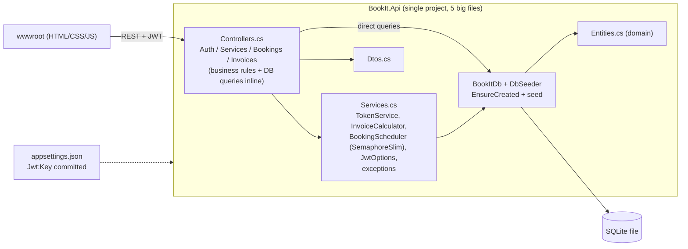
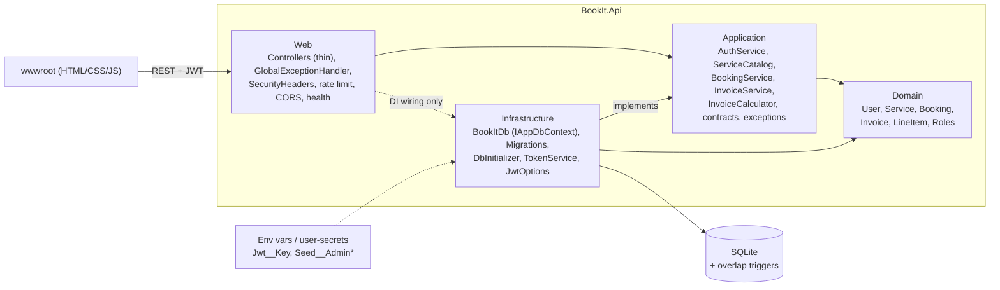

# BookIt architecture review (v1.0.0 -> v1.1.0)

Scope: the whole repository at tag `v1.0.0` (ASP.NET Core 8, EF Core + SQLite, JWT, vanilla JS frontend, xUnit).
The app is portfolio-scale, so the fixes below are deliberately proportionate: one deployable project organised
into layers, not microservices, CQRS or MediatR.

## 1. Architecture at v1.0.0

Observations: every controller talks to `BookItDb` directly; `Services.cs` mixes options, interfaces,
implementations, pure math and exceptions; configuration is read eagerly in `Program.cs`; there is no central
error handling, no roles, and concurrency safety lives in process memory.

## 2. Findings

Severity: **High** = security or data-integrity risk, **Medium** = maintainability/robustness gap that will bite
soon, **Low** = polish or accepted trade-off. Status: Fixed in 1.1.0, or Left (see section 3).

| ID | Sev | Issue | Why it matters | Fix / status |
|---|---|---|---|---|
| H1 | High | No roles: any authenticated user can create, edit and delete services (`[Authorize]` only). | Any self-registered customer can change prices or delete the catalogue. Broken access control (OWASP A01). | `Roles` (Admin/Customer) stored on `User`, emitted as a JWT role claim, enforced with `[Authorize(Roles = Admin)]` on service writes. Registration always creates Customers. Demo admin seeded in Development only; production admin comes from `Seed:AdminEmail/AdminPassword`. **Fixed** |
| H2 | High | JWT signing key committed in `appsettings.json`; no startup validation; weak keys accepted. | Anyone with the repo can mint admin-grade tokens; a short key allows brute force. | `JwtOptions` (options pattern) with DataAnnotations (required, >= 32 chars) + `ValidateOnStart`; committed key removed. Dev-only key lives in `appsettings.Development.json` and is **rejected outside Development**. Production: `Jwt__Key` env var / user-secrets (`UserSecretsId` added). **Fixed** |
| H3 | High | Double-booking prevention is a static in-process `SemaphoreSlim` around check-then-insert. | Does nothing with 2+ instances or any other writer; the guarantee silently disappears when scaled out. | Authoritative guard moved into the database: SQLite `BEFORE INSERT/UPDATE` triggers (migration `AddBookingOverlapGuard`) abort overlapping non-cancelled bookings of the same service. The app keeps a cheap pre-check for friendly errors and maps the trigger failure to `BookingConflictException` (409). Semaphore removed. Tests race 12 parallel requests and bypass the pre-check. **Fixed** |
| H4 | High | `EnsureCreated()` instead of migrations. | No schema evolution path; cannot add a column or constraint to an existing database (and H3 needs one). | EF Core migrations (`InitialCreate`, `AddBookingOverlapGuard`), `dotnet-ef` pinned in `.config/dotnet-tools.json`, `Database.MigrateAsync()` at startup. **Fixed** |
| M1 | Med | `Controllers.cs` / `Services.cs` / `Dtos.cs` / `Entities.cs`: many classes per file; business rules (ownership checks, invoice rules, payment flip) live in controllers. | Hard to navigate and test; controllers cannot be thin; logic cannot be reused. | Folder-per-layer (`Domain`, `Application`, `Infrastructure`, `Web`), one type per file, use-case services (`IAuthService`, `IServiceCatalog`, `IBookingService`, `IInvoiceService`), thin controllers. **Fixed** |
| M2 | Med | No global exception handling; ad-hoc `{ error = ... }` bodies; unhandled exceptions return framework defaults. | Inconsistent client contract; risk of leaking internals; each controller re-implements try/catch. | Typed application exceptions + one `IExceptionHandler` -> RFC 7807 ProblemDetails (with `traceId`); `UseStatusCodePages` for bare 401/403/404; unknown errors are logged and returned as an opaque 500. Frontend reads `detail`/`errors`. **Fixed** |
| M3 | Med | Thin validation (no max lengths; `[Required]` on value types); the `Service` entity is returned directly from the API; no DB length limits. | Oversized input reaches the database; entity shape is coupled to the wire contract. | Stricter DataAnnotations (lengths, ranges), `ServiceDto`, model limits/precision in `OnModelCreating`, automatic 400 ValidationProblemDetails. **Fixed** |
| M4 | Med | No throttling on `/api/auth/*`. | Online password guessing and registration spam are free. | Built-in rate limiter, fixed window per client IP (default 10/min, configurable), 429 ProblemDetails + `Retry-After`. **Fixed** |
| M5 | Med | Check-then-act races beyond bookings: duplicate registration, second invoice for a booking, double payment. | Concurrent requests can both pass the check; double payment flips twice. | Unique indexes (already present) now translated to 409 in `BookItDb.SaveChangesAsync`; payment uses a conditional `UPDATE ... WHERE IsPaid = 0` so exactly one request wins. Test included. **Fixed** |
| M6 | Med | No health endpoint; no security headers; CORS policy implicit. | Cannot be monitored or load-balanced; missing baseline browser hardening. | `/health` (includes DB check) and `/health/live`; `nosniff`, `X-Frame-Options`, `Referrer-Policy`, `Permissions-Policy`, strict CSP (the frontend has no inline script/style); explicit CORS policy that allows no cross-origin callers unless `Cors:AllowedOrigins` is set; HSTS outside Development. **Fixed** |
| M7 | Med | Settings read with `Configuration.Get<>()` at registration time, no validation, `static` constants for tax. | Overrides in tests/hosting can be missed; typos fail late and obscurely. | Options pattern everywhere (`JwtOptions`, `SeedOptions`, `RateLimitOptions`, `CorsSettings`), lazily resolved, validated on start. Tax rate stays a constant on purpose (domain rule, not deployment config). **Fixed** |
| L1 | Low | Business operations were not logged; time read via `DateTime.UtcNow` everywhere. | Hard to trace incidents; hard to test time-dependent rules. | `ILogger` in use-case services (no PII beyond ids); `TimeProvider` injected. **Fixed** |
| L2 | Low | Missing indexes on `Bookings(ServiceId, StartTime, EndTime)`, `CustomerId` columns. | Overlap check and "my bookings" scan the table. | Indexes added in the initial migration. **Fixed** |
| L3 | Low | No admin UI, so the service-management API was unusable from the frontend. | Feature gap once H1 is fixed. | Minimal admin controls (add/edit/delete service) shown only to Admins; the API remains the enforcement point. **Fixed** |
| L4 | Low | Access token stored in `localStorage`. | Readable by any XSS. | Left: strict CSP + output escaping reduce the risk; httpOnly cookies + CSRF protection is a bigger redesign than this app needs. |
| L5 | Low | No refresh tokens / revocation; role changes apply on next login (max 2 h). | Stale privileges until token expiry. | Left: acceptable for the scale; short expiry is configurable. |
| L6 | Low | Login reveals timing difference for unknown emails; no account lockout. | Minor user enumeration. | Left: rate limiting mitigates guessing. |
| L7 | Low | HTTPS redirection not configured in-app; forwarded headers not configured. | Rate limiting by IP behind a proxy sees the proxy IP. | Left: deployment concern; document `ForwardedHeaders` when put behind a reverse proxy. |
| L8 | Low | Lists are unpaged; SQLite is single-writer. | Fine for demo volumes; not for large tenants. | Left: for production scale move to PostgreSQL and replace the triggers with an exclusion constraint (`tstzrange`). |
| L9 | Low | Frontend is one `app.js` with no module split or build step; demo credentials pre-filled in the login form. | Harder to grow. | Left: no-build vanilla JS is a stated project goal; pre-fill is a demo convenience. |
| L10 | Low | Single project instead of separate Domain/Application/Infrastructure assemblies. | Layer rules are by convention, not compiler-enforced. | Left on purpose (see Decisions). |

## 3. Decisions

### What changed

**Structure.** One project, four top-level folders with namespaces matching:
`Domain` (entities, `Roles`) -> `Application` (contracts/DTOs, exceptions, use-case services, `IAppDbContext`,
`ITokenService`) -> `Infrastructure` (`BookItDb`, migrations, seeding, JWT/token code) -> `Web` (controllers,
middleware, DI/pipeline extensions, options, health check). Dependencies point inward: `Application` knows only
`Domain` and the small `IAppDbContext` abstraction, never `Infrastructure` or `Web`. `Program.cs` is ten lines.

**Double booking.** SQLite cannot express range-exclusion constraints, so a pair of triggers does it inside the
write itself. Because SQLite serialises writers across connections and processes, the check and the write cannot
interleave, whichever instance issues them. A transaction with `Serializable` isolation was considered but it only
protects code paths that remember to use it; a trigger protects every writer, including future ones and manual SQL.
Cancelled bookings never conflict and back-to-back slots are allowed (half-open intervals), matching the previous
behaviour. `BookingStatus.Cancelled == 2` is now load-bearing and documented on the enum.

**Errors.** Services throw typed exceptions (`NotFound`, `Conflict`, `BookingConflict`, `BusinessRule`,
`InvalidCredentials`, `PaymentDeclined`); one handler maps them to ProblemDetails. API contract change: error
bodies are now ProblemDetails (`detail`, `errors`) instead of `{ "error": ... }`, and auth responses gain `role`.

**Secrets and configuration.** No secret is committed for non-development use. Production needs `Jwt__Key`
(>= 32 chars); the app refuses to start otherwise or if it finds the dev key. `Seed:DemoData` is true only in
`appsettings.Development.json`.

**Tests.** 21 -> 60. Added: role enforcement, DB-trigger behaviour with the application pre-check bypassed,
12-way parallel booking races on a file-backed database (verified to fail if the trigger is removed),
concurrent payment, ProblemDetails/validation, health, security headers, CORS default, rate limiting and
startup-configuration failures.

### Intentionally left

* **No multi-assembly split, CQRS, MediatR, repositories or specification layer.** `IAppDbContext` over EF Core is
  the only abstraction; four small services do not justify more indirection. Splitting into projects is a
  mechanical follow-up if the codebase grows.
* **SQLite stays.** It satisfies the portfolio scope and the triggers make it correct. A move to PostgreSQL is the
  documented scaling path (L8).
* **Tokens remain bearer tokens in `localStorage`** (L4/L5), **no pagination, no lockout, no in-app HTTPS redirect.**
* **Upgrade note:** databases created by v1.0.0 with `EnsureCreated` have no migration history and no `Role`
  column. Delete the dev `bookit.db` and let 1.1.0 recreate it (no production deployment of 1.0.0 is known).
