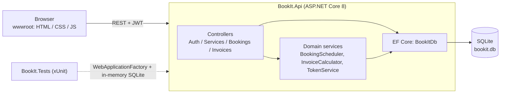

# BookIt

A small full-stack SaaS for **booking appointments and invoicing customers**, built with ASP.NET Core 8, EF Core (SQLite), JWT auth and a no-build vanilla JS frontend.

Current version: **1.0.0** (see [CHANGELOG.md](CHANGELOG.md)).

## Features

- Register / login with hashed passwords (ASP.NET Identity `PasswordHasher`) and JWT bearer authentication
- Service catalogue (name, description, price, duration) with CRUD
- Bookings with **double-booking prevention** (overlapping slots for the same service are rejected with `409`; back-to-back slots and cancelled bookings are fine)
- Invoices generated from a booking: service line + 10% tax line, total rounded to cents
- **Mock** payment endpoint to mark an invoice paid (no payment provider, no keys, no card data)
- SQLite database auto-created and seeded with demo data on startup
- Swagger UI in Development
- Plain HTML/CSS/JS frontend in `wwwroot` (no build step, no CDN): login/register, services, bookings, invoices, pay
  - light and dark mode, responsive down to phone width
  - date/time picker with end-time preview, status badges (Confirmed / Cancelled, Paid / Unpaid), invoice detail view
  - loading skeletons, empty states, inline validation, friendly toasts for slot conflicts (409) and declined payments (402)
  - accessible: labels, focus styles, skip link, keyboard-usable native dialogs
- xUnit tests (unit + in-memory SQLite + `WebApplicationFactory` integration tests)

## Screenshots

Captured from the running app with headless Edge.

| Login (inline validation) | Services |
|---|---|
|  |  |

| Booking dialog | Double-booking rejected |
|---|---|
|  |  |

| Invoice detail | Dark mode |
|---|---|
|  |  |

Mobile (375 px wide):


## Architecture



Data model: `User 1-* Booking *-1 Service`, `Booking 1-0..1 Invoice 1-* InvoiceLineItem`.

## Run

Requires the .NET 8 SDK.

```bash
dotnet run --project src/BookIt.Api --launch-profile http
```

Then open <http://localhost:5243> (frontend) or <http://localhost:5243/swagger> (Swagger UI, Development only).
`bookit.db` is created in the working directory on first start.

**Demo credentials (test values, seeded):** `demo@bookit.test` / `Demo#12345`

The JWT signing key in `appsettings.json` is a dev-only placeholder; override it with the `Jwt__Key` environment variable for any real deployment.

## Test

```bash
dotnet test
```

Covers password hashing and login, double-booking prevention (scheduler and HTTP level), invoice total calculation, the booking -> invoice -> mock payment flow, and per-user data isolation.

## API

All endpoints are under `/api`. Bearer token required unless noted.

| Method | Path | Description |
|---|---|---|
| POST | `/auth/register` | Create account, returns JWT (public) |
| POST | `/auth/login` | Returns JWT (public) |
| GET | `/services` | List active services (public; `?includeInactive=true`) |
| GET | `/services/{id}` | Get a service (public) |
| POST | `/services` | Create service |
| PUT | `/services/{id}` | Update service |
| DELETE | `/services/{id}` | Delete service (409 if it has bookings) |
| GET | `/bookings` | List my bookings |
| GET | `/bookings/{id}` | Get one of my bookings |
| POST | `/bookings` | Create booking `{serviceId, startTime, notes}`; 409 on overlap |
| PUT | `/bookings/{id}` | Reschedule `{startTime}`; 409 on overlap |
| POST | `/bookings/{id}/cancel` | Cancel (frees the slot) |
| DELETE | `/bookings/{id}` | Delete (not allowed once invoiced) |
| POST | `/bookings/{id}/invoice` | Generate invoice from booking |
| GET | `/invoices` | List my invoices |
| GET | `/invoices/{id}` | Get invoice with line items |
| POST | `/invoices/{id}/pay` | **Mock** payment; body `{"succeed": false}` simulates a decline (402) |

## Design notes and limitations

- A "slot" is per service: each service is treated as a single resource. Check-then-insert is serialised in-process; a multi-instance deployment would need a database-level constraint.
- Any authenticated user can create/edit services (no roles) - fine for a demo, not for production.
- The schema is created with `EnsureCreated` rather than EF migrations to avoid requiring the `dotnet ef` tool.
- Times are stored and returned in UTC.

## Project layout

```
BookIt.sln
src/BookIt.Api/     Controllers, Domain, Data (DbContext + seeder), Services, Dtos, wwwroot
tests/BookIt.Tests/ xUnit tests
```
