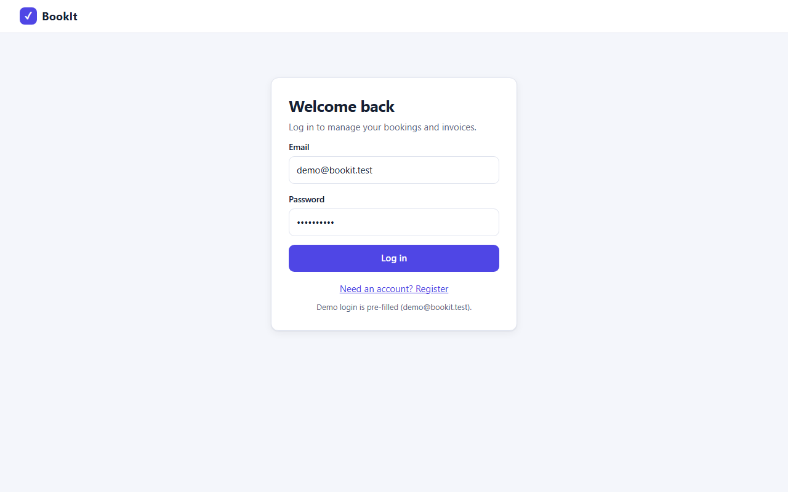
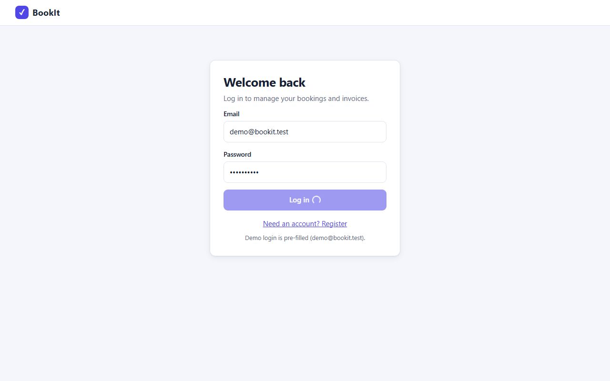
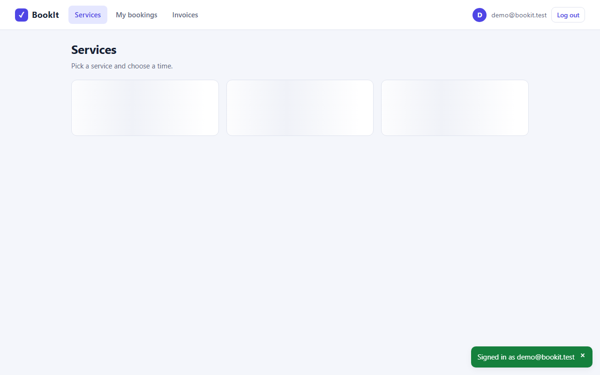
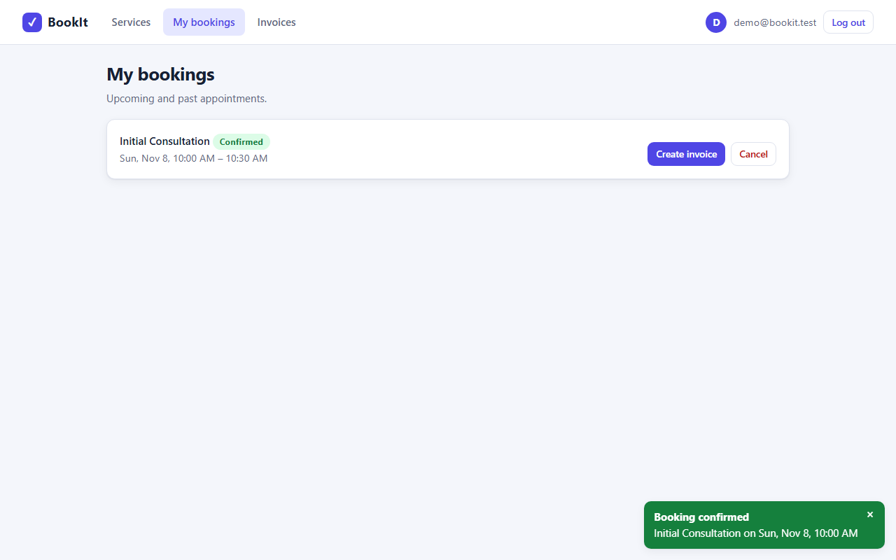
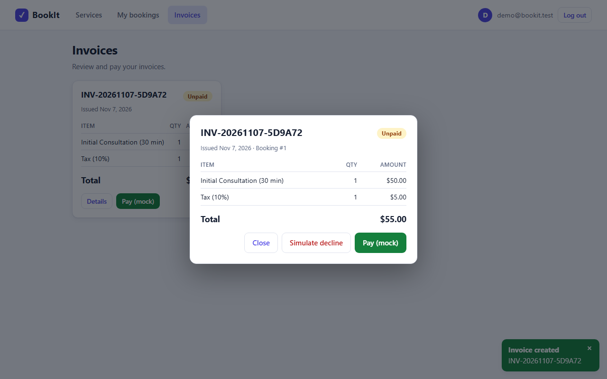
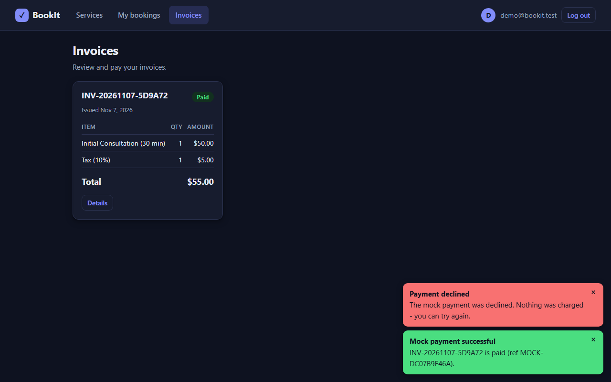
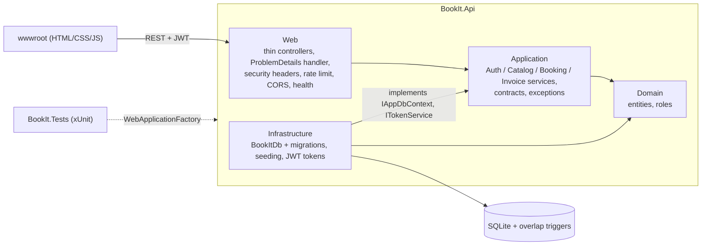

# BookIt

A small full-stack SaaS for **booking appointments and invoicing customers**, built with ASP.NET Core 8, EF Core (SQLite), JWT auth and a no-build vanilla JS frontend.

Current version: **1.2.0** (see [CHANGELOG.md](CHANGELOG.md)).

## Features

- Register / login with hashed passwords (ASP.NET Identity `PasswordHasher`) and JWT bearer authentication
- Service catalogue (name, description, price, duration); Admin-only management, customers book and pay
- Bookings with **double-booking prevention** (overlapping slots for the same service are rejected with `409`; back-to-back slots and cancelled bookings are fine)
- Invoices generated from a booking: service line + 10% tax line, total rounded to cents
- **Mock** payment endpoint to mark an invoice paid (no payment provider, no keys, no card data)
- SQLite schema managed by EF Core migrations at startup; demo data seeded in Development
- Swagger UI in Development
- Plain HTML/CSS/JS frontend in `wwwroot` (no build step, no CDN): login/register, services, bookings, invoices, pay
  - light and dark mode, responsive down to phone width
  - date/time picker with end-time preview, status badges (Confirmed / Cancelled, Paid / Unpaid), invoice detail view
  - loading skeletons, empty states, inline validation, friendly toasts for slot conflicts (409) and declined payments (402)
  - accessible: labels, focus styles, skip link, keyboard-usable native dialogs
- Hardening: ProblemDetails errors, request validation, auth rate limiting, security headers, health checks
- xUnit tests (unit + in-memory SQLite + `WebApplicationFactory` integration tests)

## Screenshots

Captured from the running app with headless Edge.

| Login (inline validation) | Services |
|---|---|
|  |  |

| Booking dialog | Double-booking rejected |
|---|---|
|  |  |

| Invoice detail | Dark mode |
|---|---|
|  |  |

Mobile (375 px wide):


## Architecture

One deployable project (`src/BookIt.Api`) organised into layers; dependencies point inward. See
[ARCHITECTURE_REVIEW.md](ARCHITECTURE_REVIEW.md) for the review, findings and the reasoning behind each decision.



| Folder (`src/BookIt.Api`) | Responsibility |
|---|---|
| `Domain/` | Entities (`User`, `Service`, `Booking`, `Invoice`, `InvoiceLineItem`), `BookingStatus`, `Roles` |
| `Application/` | Use-case services (`AuthService`, `ServiceCatalog`, `BookingService`, `InvoiceService`), `InvoiceCalculator`, request/response contracts, typed exceptions, `IAppDbContext` |
| `Infrastructure/` | `BookItDb` (EF Core), migrations, `DbInitializer` (migrate + seed), `TokenService`, `JwtOptions` |
| `Web/` | Controllers, `GlobalExceptionHandler` (ProblemDetails), security-headers middleware, health check, DI/pipeline extensions, options |
| `wwwroot/` | Static frontend |

Key design points:

- **Double-booking is prevented by the database**, not by process memory: SQLite triggers (migration `AddBookingOverlapGuard`) reject overlapping non-cancelled bookings of the same service on insert/update, so racing requests and multiple instances are safe. The service layer pre-checks for a friendly error and translates the database rejection to `409`.
- **Roles:** `Customer` (default for registrations) can book and pay; only `Admin` can create/edit/delete services.
- **Errors** are RFC 7807 ProblemDetails everywhere (`409` conflict, `402` declined mock payment, `400` validation, `429` throttled, ...).
- **Schema** is managed by EF Core migrations, applied automatically at startup.

Data model: `User 1-* Booking *-1 Service`, `Booking 1-0..1 Invoice 1-* InvoiceLineItem`.

## Run

Requires the .NET 8 SDK.

```bash
dotnet run --project src/BookIt.Api --launch-profile http
```

Then open <http://localhost:5243> (frontend) or <http://localhost:5243/swagger> (Swagger UI, Development only).
`bookit.db` is created and migrated in the working directory on first start. If you have a database from v1.0.0, delete it first (it was created without migrations).

**Demo accounts (test values, seeded only in Development):**

| Role | Email | Password |
|---|---|---|
| Customer | `demo@bookit.test` | `Demo#12345` |
| Admin | `admin@bookit.test` | `Admin#12345` |

### Configuration

| Setting | Purpose |
|---|---|
| `Jwt:Key` (env `Jwt__Key`) | **Required**, at least 32 characters. Not committed; the app refuses to start without it. `appsettings.Development.json` carries a clearly marked dev-only key which is rejected in any other environment. Use `dotnet user-secrets set "Jwt:Key" "<secret>" --project src/BookIt.Api` or an environment variable. |
| `ConnectionStrings:Default` | SQLite connection string (default `Data Source=bookit.db`) |
| `Seed:DemoData` | Seed demo users and sample services (true only in Development) |
| `Seed:AdminEmail` / `Seed:AdminPassword` | Provision an Admin on startup in any environment (supply the password via env var or secrets) |
| `RateLimiting:AuthPermitLimit` / `AuthWindowSeconds` | Per-IP limit for `/api/auth/*` (default 10 per 60 s) |
| `Cors:AllowedOrigins` | Allowed cross-origin callers (none by default; the bundled frontend is same-origin) |

Production example:

```bash
export ASPNETCORE_ENVIRONMENT=Production
export Jwt__Key="$(openssl rand -base64 48)"
export Seed__AdminEmail=owner@example.com
export Seed__AdminPassword="<strong password>"
dotnet run --project src/BookIt.Api
```

### Health

`GET /health` (includes a database check) and `GET /health/live` (process only).

### Migrations

`dotnet-ef` is pinned as a local tool (`.config/dotnet-tools.json`):

```bash
dotnet tool restore
dotnet ef migrations add <Name> -p src/BookIt.Api -o Infrastructure/Persistence/Migrations
```

## Test

```bash
dotnet test
```

60 tests: password hashing and login, role enforcement (401/403/200), double-booking (service level, HTTP level, database triggers with the pre-check bypassed, and 12-way parallel races on a file-backed database), invoice maths, booking -> invoice -> mock payment, concurrent double payment, per-user data isolation, ProblemDetails and validation, health, security headers, CORS default, rate limiting, and startup failure without a valid JWT key.

## API

All endpoints are under `/api`. Bearer token required unless noted. Errors are `application/problem+json`.

| Method | Path | Role | Description |
|---|---|---|---|
| POST | `/auth/register` | public | Create a Customer account, returns JWT (rate limited) |
| POST | `/auth/login` | public | Returns JWT incl. `role` (rate limited) |
| GET | `/services` | public | List active services (`?includeInactive=true` honoured for Admins only) |
| GET | `/services/{id}` | public | Get a service |
| POST | `/services` | Admin | Create service |
| PUT | `/services/{id}` | Admin | Update service |
| DELETE | `/services/{id}` | Admin | Delete service (409 if it has bookings) |
| GET | `/bookings` | user | List my bookings |
| GET | `/bookings/busy?serviceId=&from=&to=` | user | Taken time ranges of a service (max 31 days); times only, no identities |
| GET | `/bookings/{id}` | user | Get one of my bookings |
| POST | `/bookings` | user | Create booking `{serviceId, startTime, notes}`; 409 on overlap |
| PUT | `/bookings/{id}` | user | Reschedule `{startTime}`; 409 on overlap |
| POST | `/bookings/{id}/cancel` | user | Cancel (frees the slot); idempotent; 409 once paid, 400 if completed |
| DELETE | `/bookings/{id}` | user | Delete (not allowed once invoiced) |
| POST | `/bookings/{id}/invoice` | user | Generate invoice from booking |
| GET | `/invoices` | user | List my invoices |
| GET | `/invoices/{id}` | user | Get invoice with line items |
| POST | `/invoices/{id}/pay` | user | **Mock** payment; body `{"succeed": false}` simulates a decline (402) |
| GET | `/health`, `/health/live` | public | Health checks (outside `/api`) |

## Design notes and limitations

- A "slot" is per service: each service is treated as a single resource.
- Times are stored and returned in UTC.
- Bearer tokens are kept in `localStorage` and roles are baked into the token (changes apply at next login); a strict CSP and output escaping mitigate XSS. No refresh tokens, pagination or account lockout.
- SQLite is single-writer. For larger deployments move to PostgreSQL and replace the triggers with an exclusion constraint.
- Behind a reverse proxy, configure forwarded headers and HTTPS redirection there so rate limiting sees client IPs.

## Project layout

```
BookIt.sln
ARCHITECTURE_REVIEW.md
.config/dotnet-tools.json   pinned dotnet-ef
src/BookIt.Api/
  Domain/  Application/  Infrastructure/  Web/   (layers, see Architecture)
  wwwroot/                                       static frontend
tests/BookIt.Tests/         xUnit tests (+ Support/ factories)
```
